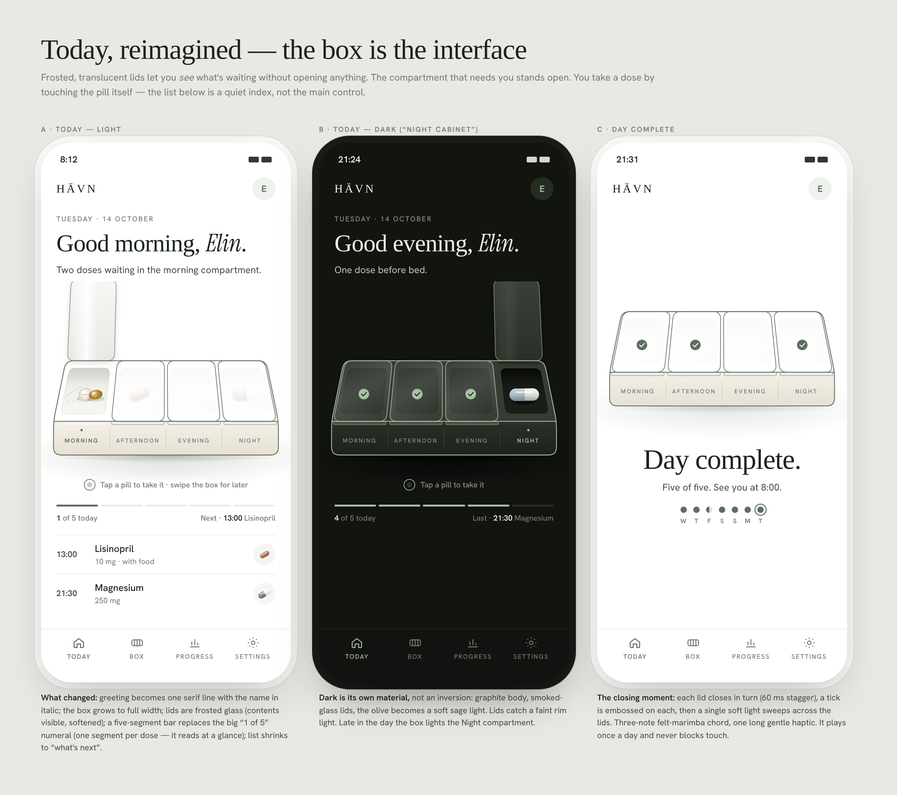
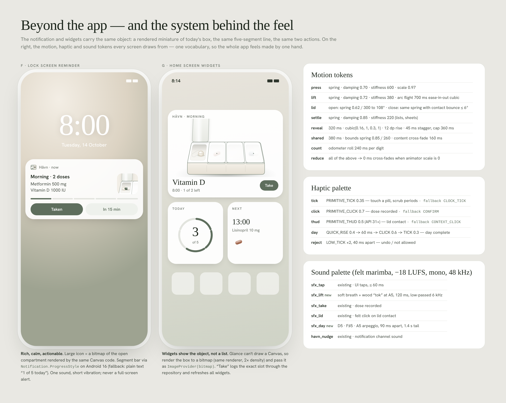

# Hävn — Premium Experience Brief (v2)

> **For the implementing agent.** This brief is the source of truth for the
> next design and engineering pass. Read it end to end, then look at every
> image in `assets/`, play `assets/take-moment-with-sound.mp4`, and open the
> concept renderer in `concept/` before writing code. Work in the priority
> order below, one small PR per item.

---

## 0. What "premium" means here

Hävn already looks right: white page, the logo's olive, Instrument Serif and
Hanken Grotesk, hairlines instead of shadows. It still feels ordinary because
**you look at the product instead of handling it**. Luxury apps (Things 3,
Calm, Revolut, Apple Fitness) feel expensive for three reasons. This pass is
about exactly those three:

1. **The core object is the interface.** The pill organiser is not an
   illustration on Today, it *is* Today. You take a dose by touching the
   pill. Lids open and close because of what you do.
2. **One choreography.** Everything moves with physics from a single token
   set (§5). Nothing pops in or snaps. Every motion can be interrupted.
3. **Every moment is designed in three senses.** Each state change has a
   timed visual beat, a matching haptic and a matching sound, landing on the
   same frame.

### Principles (reject work that breaks one)

- **Calm over clever.** Healthcare app, users of every age. No confetti, no
  streak guilt, no bouncing for its own sake. Springs are damped (≥ 0.6).
- **Reliability is the luxury.** Never trade reminder reliability, data
  safety or accessibility for an effect.
- **Same object everywhere.** App, notification, widget and onboarding all
  show the same box, drawn by the same renderer.
- **Reduce motion is a first-class mode**, not a fallback (§4 P12).
- **Offline and private.** No network permission, no analytics SDKs, no
  remote assets. Everything ships in the APK.

---

## 1. Repository facts you must respect

| Thing | Value |
|---|---|
| App | Native Android, Kotlin, Jetpack Compose, Material 3, Hilt, Room, DataStore, Glance widget |
| Package / namespace | `com.havnmeds.app` / `com.havn.app` |
| SDK | minSdk 26, targetSdk 35, compileSdk 35 |
| Compose BOM | `2024.06.00` (bump to ≥ `2024.09.00` for shared elements, see P8) |
| Theme tokens | `ui/theme/HavnColors.kt`, `HavnTokens.kt` (incl. `linen`), `HavnTheme.kt`, `HavnMotion.kt`, `HavnTypography.kt` |
| The organiser | `ui/components/HavnOrganizerView.kt` (Canvas renderer, `HavnPillSpecimen`) |
| Today | `ui/screens/home/HomeScreen.kt`, `HomeViewModel.kt` (`toggleDose`, `setStatus`, `markAllRemaining`) |
| Haptics | `ui/components/HavnPress.kt` → `rememberHavnHaptics()` (`tick`, `click`, `latch`, `confirm`, `release`, `celebrate`) |
| Sound | `audio/SoundManager.kt` (SoundPool) + `res/raw/{sfx_tap, sfx_take, sfx_lid, havn_nudge}.wav` (22 050 Hz mono 16-bit) |
| Reminders | `notifications/HavnAlarmScheduler.kt`, `AlarmReceiver.kt`, `HavnNotificationChannels.kt` |
| Widget | `widget/HavnWidget.kt`, `HavnWidgetPalette.kt` |
| Tests | `app/src/test/.../LaunchSmokeTest.kt` (Robolectric, boots the real app, walks every screen, writes PNGs to `app/build/screenshots/`) and `data/db/MigrationTest.kt` |
| CI | `.github/workflows/check.yml` builds, runs unit tests, uploads APK + screenshots |

Known gaps this brief fixes along the way:
- `HomeScreen.kt` `DayCompleteOverlay` has `val reduceMotion = remember { false }`, a stub.
- The organiser exposes only one summary `contentDescription`; individual pills are not accessible or testable.
- `android:enableOnBackInvokedCallback` is not set, so predictive back is off.

---

## 2. The look: materials and light

Reference: `assets/01-today.png`, `concept/box.js` (`drawBox`, `pill`).

- **Frosted lids.** Closed lids are translucent white (light: ~80 % opacity
  with a diagonal gradient; dark: smoked glass ~72 %). Pills under a closed
  lid show through **softened** (blur ≈ 2 dp, slightly desaturated), so you
  can see what's waiting without opening anything. One diagonal specular
  streak per lid.
- **Open lid underside.** A denser frosted panel with its own soft shadow
  (blur 18 px, y +6) so it separates from a white page.
- **Body.** Linen front face (`linen` token → `#F4F0E8`–`#E6E0D4` gradient)
  with a 1 px highlight under the lip. Top rim white. The olive outline stays
  (`#5E6E5D`, ~1.1× stroke on the silhouette).
- **Wells.** Floor gradient `#ECEAE4 → #F7F6F2`, back-wall shadow band (30 %
  of depth, 14 % shadow tint).
- **Pills.** Sculpted with light from the upper left: capsule halves with
  vertical gradients and a highlight streak; tablet with radial gradient, inner
  bevel ring and score; softgel translucent with a glossy highlight; oval
  caplet. Taken doses leave a **dashed ghost outline**.
- **Ground.** Two shadows: a wide soft pool and a tight contact shadow.
- **Dark mode is its own material ("night cabinet"):** graphite body
  `#2A2F27 → #1E221C`, smoked lids, sage-light outline `#A8C0A4`, deep wells
  `#141712`. See panel B.

**Implementation.** Keep the Canvas renderer (fast, no assets) and upgrade it
to match `concept/box.js`. Draw it in two stacked layers so the frosting is
real:
1. `wells + pills` layer;
2. `closed-compartment pills` layer with `Modifier.graphicsLayer { renderEffect = BlurEffect(r, r) }` (API 31+; below 31 draw those pills at 55 % alpha and 25 % lighter instead);
3. `lids + outline` layer.

Port `pill()` gradients 1:1 (`Brush.linearGradient` / `radialGradient`).

---

## 3. The signature moment: taking a dose

Reference: `assets/02-take-moment.png`, `assets/take-moment-with-sound.mp4`
(the definitive timing), `concept/anim.html` (`pillState`, `lidAngle`).

| t (ms) | Visual | Haptic | Sound |
|---|---|---|---|
| 0 | Touch-down on a pill: it rises 3 dp, scales to 1.06, shadow widens; touch ripple ring; neighbours dim to 70 % | tick 0.35 | — |
| 0–150 | press held (release or 220 ms long-press to commit; finger drag-off cancels) | — | — |
| 150–850 | Pill flies on a quadratic arc (control point 1.5× box depth above) to the next empty segment of the day line; scales 1.06 → 0.40; ease-in-out cubic | — | `sfx_lift` at launch |
| 850 | Lands: segment fills, counter rolls (odometer), lede text updates | click 0.7 | `sfx_take` |
| +100 | If the compartment is now empty, a tick **draws** on its floor (200 ms) | — | — |
| +350 | Lid closes: damped contact bounce `108° · e^(−6s) · |cos 6.5s|` | thud 0.5 at first contact | `sfx_lid` at contact |
| after | Lid shows embossed tick; next compartment's status dot pulses once; 4 s **Undo** snackbar | — | — |

Rules:
- Interruptible at every point: a second tap on another pill while one is in
  flight just starts a second flight; undo reverses the flight (pill returns
  to the well, lid re-opens).
- The **data write happens at touch-commit**, not at landing, so killing the
  app mid-animation never loses a dose. The animation is presentation only.
- Taking a dose that is *not* in the open compartment (e.g. from the list):
  that compartment's lid opens, the pill lifts out, then the same sequence.
- Skipping: long-press the pill → sheet with Take / Skip / Details. Skip
  plays a short sideways slide out (no flight) + reject haptic.

---

## 4. Work items, in priority order

Each item: small PR, screenshots from `LaunchSmokeTest` attached, CI green.

### P1 · Pills are touchable (the signature moment)
- Expose per-pill hit areas from the organiser: compute each pill's
  screen-space center and radius in the same geometry code, and overlay
  invisible `Box`es with `Modifier.semantics { contentDescription = "Metformin 500 mg, 8:00, not taken"; onClick(label = "Take") { … } }` and pointer input. This makes pills accessible (TalkBack can take a dose) **and** testable.
- Implement the timeline in §3 with `Animatable`s owned by a small
  `OrganizerAnimator` state holder (one per in-flight pill) so the canvas is
  a pure function of state.
- Wire to `HomeViewModel.setStatus(dose, TAKEN)`; Undo → `PENDING`.
- **Accept when:** touching a pill on Today logs that exact slot; the flight
  lands on the right segment; empty compartments close themselves; Undo
  restores; TalkBack can take each pill by name; works with the lid already
  open or closed.

### P2 · Materials pass on the organiser (light + dark)
- Everything in §2. Same API (`HavnOrganizerView(doses, selectedPeriod, onSlotTapped)`), plus an optional `onPillTapped`.
- **Accept when:** a side-by-side of `LaunchSmokeTest` `02-today.png` against `assets/01-today.png` panel A shows frosted lids with visible softened contents, a lid underside with shadow, sculpted pills and two-layer ground shadow; dark mode matches panel B.

### P3 · Lid physics
- One lid controller per compartment: opens to 108° when its period becomes
  focused (spring 0.62 / 300), closes with the contact bounce from §3 when
  emptied or unfocused. Lids never snap.
- **Accept when:** focusing a period opens its lid and closes the previous one; all transitions are interruptible mid-swing.

### P4 · Scrub the day on the box
- Horizontal drag across the box moves focus Morning → Night with detents:
  the lid under your finger opens, haptic tick per detent; fling settles on
  the nearest compartment. The period labels on the front face are the
  indicator, so no separate tabs are needed.
- **Accept when:** dragging across opens each compartment in turn with one tick per detent; release settles; vertical scroll on Today is not hijacked (use `detectHorizontalDragGestures` with touch slop).

### P5 · Today layout refresh
- Greeting on one serif line with the name in Instrument Serif *italic*.
- A one-line lede that narrates state ("Two doses waiting in the morning compartment." → "Morning done. Next · Lisinopril at 13:00.").
- Box full-bleed under the lede.
- Hint line under the box ("Tap a pill to take it · swipe the box for later"), shown for the first 3 sessions only.
- The big "1 of 5" numeral becomes a **five-segment line**: one segment per scheduled dose, filled in order taken, with "1 of 5 today · Next 13:00 Lisinopril" under it.
- The dose list shrinks to "what's next" rows (time, name, dose, mini pill glyph).
- **Accept when:** matches `assets/01-today.png` panel A within normal tolerance; all existing actions (log all, manage, progress) remain reachable.

### P6 · Haptic palette
- Rewrite `HavnHaptics` around `VibrationEffect.Composition` (API 30+) with
  `Vibrator.areAllPrimitivesSupported` checks and the fallbacks in §5. Keep
  `LocalHapticFeedback` for API < 30.
- Respect the system "Touch feedback" setting and an in-app toggle.
- **Accept when:** each named haptic in §5 exists as one function, is used at the beats in §3, and degrades on devices without primitives.

### P7 · Sound palette
- Add `res/raw/sfx_lift.wav` and `res/raw/sfx_day.wav`. Drafts are in
  `assets/sound/`, generated by `concept/make_sounds.py` (reproducible,
  loudness-matched to `sfx_take`). **Audition them before shipping**; regenerate
  or replace with a sound designer's versions if they don't feel right.
- `SoundManager`: add `playLift()`, `playDay()`; route through the existing
  "Interface sounds" toggle; never play when ringer mode is silent/vibrate.
- **Accept when:** the four interaction sounds fire at the §3 beats and nothing plays in silent mode.

### P8 · Shared-element detail
- Bump Compose BOM to ≥ `2024.09.00` (Compose 1.7) and Navigation ≥ 2.8.
- Long-press a pill (or tap a list row) → the pill morphs into the specimen
  tray of a new **Medication detail** screen (`assets/03-detail-onboarding.png`
  panel D) using `SharedTransitionLayout` + `Modifier.sharedElement` /
  `sharedBounds`.
- Detail content: name, dose and instructions, today's slots as cards (taken
  time or "due in 12 min"), 14-day dot history (taken, missed, skipped),
  notes, actions (Skip, Take now), and Edit in the top bar.
- Turn on predictive back (`android:enableOnBackInvokedCallback="true"`) so
  the back gesture scrubs the transition in reverse.
- **Accept when:** the transition is continuous both ways and interruptible by the back gesture.

### P9 · Day complete
- On the last dose of the day: lids close in turn (60 ms stagger), ticks are
  embossed, one soft light sweep crosses the lids, the "day" haptic and
  `sfx_day` play. The serif line "Day complete." and a 7-day dot row appear.
  Max once per day, never blocks touch (`assets/01-today.png` panel C).
- Replace the `reduceMotion` stub with the real setting (P12).

### P10 · First launch: the box assembles
- `assets/03-detail-onboarding.png` E1–E3:
  - the base rises from white;
  - four lids drop in, 90 ms apart, tick plus light haptic each;
  - the wordmark fades in;
  - "Who is this box for?" engraves the name on the box's front face live as you type;
  - after the first medicine is added, its pill drops into the right compartment and the lid closes over it.
- Skippable; under reduce motion the finished box simply appears.

### P11 · Notification and widget carry the object
- **Notification large icon:** a bitmap of the open compartment rendered by
  the same renderer into an offscreen `Canvas(Bitmap)`. Keep the actions
  "Taken" and "In 15 min". On Android 16 (needs compileSdk 36), add
  `Notification.ProgressStyle` with one segment per dose; otherwise use the
  text "1 of 5 today".
- **Widgets:**
  - 4×2 with the mini box bitmap, next dose and a Take button;
  - 2×2 segmented ring "3 of 5";
  - 2×2 "Next" card.

  Glance can't draw a Canvas, so pass `ImageProvider(bitmap)`. Keep the
  existing slot-correct logging (`setFromWidget`).
- **Accept when:** both match `assets/04-system.png` panels F and G, and Take from either surface logs the exact slot and clears the matching notification.

### P12 · Reduce motion, accessibility, performance
- `LocalReduceMotion` CompositionLocal, read from
  `Settings.Global.ANIMATOR_DURATION_SCALE == 0f` (re-read on resume).
  Every motion token falls back to a 0–120 ms cross-fade. The flight becomes
  a fade-out in the well plus a fade-in segment.
- Touch targets ≥ 48 dp (the pill hit areas may extend beyond the drawn pill).
- Contrast ≥ 4.5:1 for text on linen and frosted surfaces.
- Font scale 200 % must not clip the greeting or the box labels; the labels shrink to 3-letter forms.
- Add Baseline Profiles (`androidx.baselineprofile` plus a `:baselineprofile` macrobenchmark module) for startup, and for Today's first frame and scroll. Generating them needs a device or emulator.
- No dropped frames on a mid-range device at 120 Hz: the organiser must not allocate per frame (cache `Path`s and `Brush`es, reuse `TextLayoutResult`s).

### P13 (optional, needs specialists) · Real 3D and authored motion
- **3D:** a Blender model of the organiser (frosted PP lids, linen body,
  olive hinge line), rendered with Google **Filament** (`com.google.android.filament`)
  in a `TextureView`, with lid bones driven by the same lid controllers.
  Commission a 3D artist; the Canvas renderer stays as the fallback and for
  widgets and notifications.
- **Authored animation:** Rive (`app.rive:rive-android`) state machines for the
  onboarding assembly and day-complete, if a motion designer is engaged.

---

## 5. Tokens (one vocabulary for the whole app)

### Motion (`HavnMotion.kt`)
| Token | Spec |
|---|---|
| press | spring damping 0.70, stiffness 600, scale 0.97 |
| lift | spring 0.72 / 380; arc flight 700 ms ease-in-out cubic |
| lid | open spring 0.62 / 300 to 108°; close with contact bounce ≤ 6° |
| settle | spring 0.85 / 220 (lists, sheets) |
| reveal | 320 ms, cubic(0.16, 1, 0.3, 1), 12 dp rise, 45 ms stagger, cap 360 ms |
| shared | 380 ms; bounds spring 0.85 / 260; content cross-fade 160 ms |
| count | odometer roll 240 ms per digit |
| reduce | everything → 0–120 ms cross-fade |

### Haptics (`HavnHaptics`)
| Name | Primitive (API 30+) | Fallback | Used for |
|---|---|---|---|
| tick | PRIMITIVE_TICK 0.35 | CLOCK_TICK | touch a pill, scrub detents |
| click | PRIMITIVE_CLICK 0.7 | CONFIRM | dose recorded |
| thud | PRIMITIVE_THUD 0.5 (API 31+) | CONTEXT_CLICK | lid contact |
| day | QUICK_RISE 0.4 → 60 ms → CLICK 0.6 → TICK 0.3 | LONG_PRESS | day complete |
| reject | LOW_TICK ×2, 40 ms apart (API 31+) | REJECT | undo, skip, not allowed |

### Sound (`SoundManager`, felt marimba, 22 050 Hz mono, matched to `sfx_take` loudness)
| File | Status | Character |
|---|---|---|
| sfx_tap | existing | UI taps, ≤ 60 ms |
| sfx_lift | **new (draft)** | breath swell + wooden "tok" at A5, 160 ms |
| sfx_take | existing | dose recorded |
| sfx_lid | existing | felt click on lid contact |
| sfx_day | **new (draft)** | D5 · F♯5 · A5 arpeggio, 90 ms apart, 1.6 s tail |
| havn_nudge | existing | notification channel sound |

---

## 6. Verification

- **Every PR:** run `./gradlew :app:assembleDebug :app:testDebugUnitTest`.
  Extend `LaunchSmokeTest` with the new states:
  - a pill mid-flight;
  - a lid mid-close;
  - day complete;
  - the detail screen;
  - first launch E1–E3;
  - dark mode;
  - reduce motion.

  Attach the PNGs from `app/build/screenshots/` and compare them to `assets/`.
  The test pauses the clock (`mainClock.autoAdvance = false`) because of
  infinite ambient animations. Advance it with `pump()`.
- **Gesture tests:** `performTouchInput { down(center); up() }` on the pill
  semantics nodes from P1, then assert the dose log and the segment count.
- **On a real device before release:**
  1. Take a dose with the screen reader on.
  2. Take one with reduce motion on.
  3. Take one in silent mode (vibration only).
  4. Take one from the notification.
  5. Take one from the widget.
  6. Kill the app mid-flight and confirm the dose is still logged.
  7. Check for dropped frames with GPU profiling.

## 7. Guardrails / non-goals

- No drug-interaction or dosage advice of any kind (needs a licensed database
  and clinical sign-off).
- No network access, accounts, analytics or remote config.
- Don't touch reminder scheduling semantics (`HavnAlarmScheduler`,
  `AlarmReceiver`) except to call new sounds and haptics.
- Don't change the Room schema without a migration and a `MigrationTest` case.
- Keep the white and olive identity, the two typefaces and the hairline
  language. This pass is about feel, not a rebrand.

## 8. Files in this folder

| Path | What |
|---|---|
| `assets/01-today.png` | Today light, dark, day complete |
| `assets/02-take-moment.png` | Storyboard + timeline of the take moment |
| `assets/03-detail-onboarding.png` | Shared-element detail, first launch E1–E3 |
| `assets/04-system.png` | Lock-screen notification, widgets, motion, haptic and sound tokens |
| `assets/take-moment.mp4` / `.gif` | The take moment at 30 fps (silent) |
| `assets/take-moment-with-sound.mp4` | Same, with the sound cues at their exact timestamps |
| `assets/sound/sfx_lift.wav`, `sfx_day.wav` | Draft new sounds (audition before shipping) |
| `concept/box.js` | Reference renderer: geometry, materials, pills, lid flight. Port this. |
| `concept/board*.html`, `anim.html`, `common.css` | Sources of the boards and the animation (fonts: copy `app/src/main/res/font/*.ttf` into `concept/fonts/` to render) |
| `concept/make_sounds.py` | Reproducible generator for the draft sounds |
| `PROMPT.md` | Paste-ready kickoff prompt for an implementing agent |
